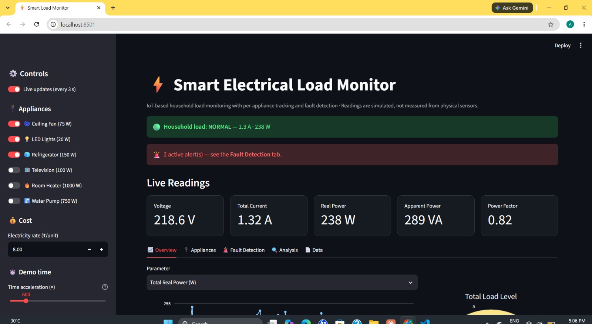
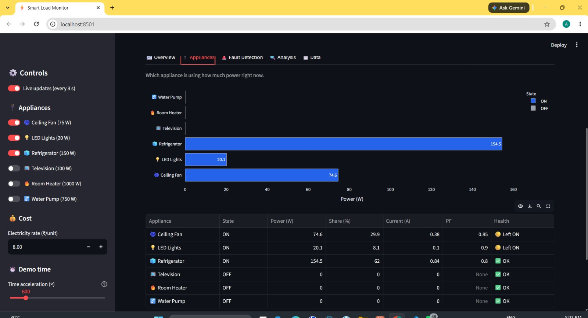
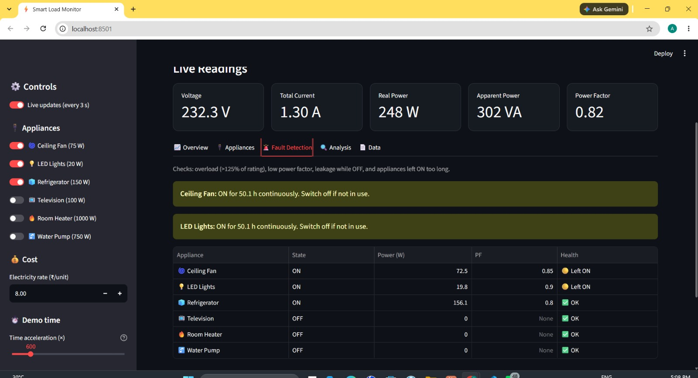
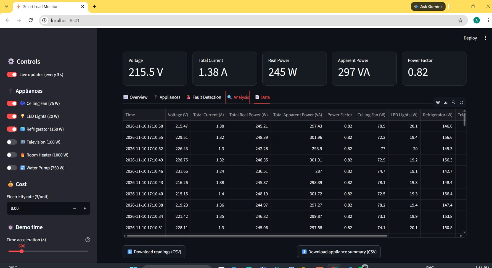
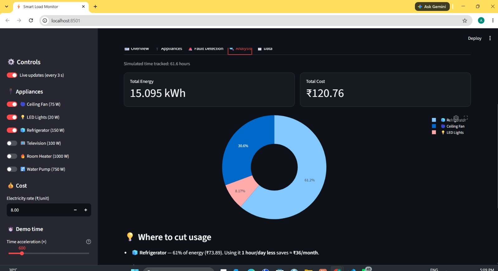

# Smart Electrical Load Monitoring System

IoT-based household load monitoring with per-appliance tracking and fault detection.

## Current Status
- Software dashboard (v1): Completed. Readings are **simulated**, not measured from physical sensors
- Hardware (ESP32 + sensors + PCB): In progress, components ordered

## Problem Statement
Households usually see only a monthly electricity bill and have no idea which appliance uses how much power, or when something is wrong. This project aims to monitor household load in real time, show per-appliance consumption and cost, and warn about faults such as overload or wasted power.

## Objectives
- Monitor voltage, current, real power, apparent power and power factor
- Track power consumption of individual appliances
- Calculate energy consumption and electricity cost
- Detect faults: overload, low power factor, standby leakage, forgotten-ON appliances
- Build the actual hardware using an ESP32 with voltage and current sensors

## Features
- Live dashboard with voltage, current, real power, apparent power, power factor
- Per-appliance power monitoring
- Energy consumption and electricity cost calculation
- Fault detection with alerts
- Graphs, analysis and data table

## Technologies Used
- Built: Python, Streamlit, Pandas, Plotly
- Planned (hardware): ESP32, SCT013 current sensor, ZMPT101B voltage sensor, MQTT

## Working Principle
## Working Principle
- Each appliance has a rated power and power factor (e.g. Ceiling Fan: 75 W, PF 0.85)
- When an appliance is ON, its real power is simulated as the rated value with about ±5% random variation. Voltage is simulated randomly between 215 V and 235 V
- Per appliance: apparent power S = P / PF, reactive power Q = sqrt(S^2 - P^2), current = S / V
- Household totals: P and Q of all appliances are added, then total S = sqrt(P^2 + Q^2), total PF = P / S, total current = S / V
- Energy (kWh) is accumulated over time. A "time acceleration" slider (default 600x) makes simulated time run faster than real time so energy and cost build up visibly in a demo
- Cost = energy x electricity rate set by the user
- The dashboard auto-refreshes every 3 seconds
- Load status: NORMAL below 4 A, MODERATE between 4 A and 8 A, HIGH above 8 A
- Fault checks: overload (above 125% of rated power), low power factor (0.15 below rated), leakage (power drawn while OFF), forgotten-ON (continuously ON longer than the set hours)
- Overload, low PF and leakage are injected for demo using the "Fault simulation" panel in the sidebar
- Note: voltage, power factor and appliance loads are simulated. In the final system, real sensors will provide these values
## Screenshots

### Overview





### Appliances





### Fault Detection





### Data





### Analysis





## How to Run
```
pip install -r requirements.txt
streamlit run app2.py
```
